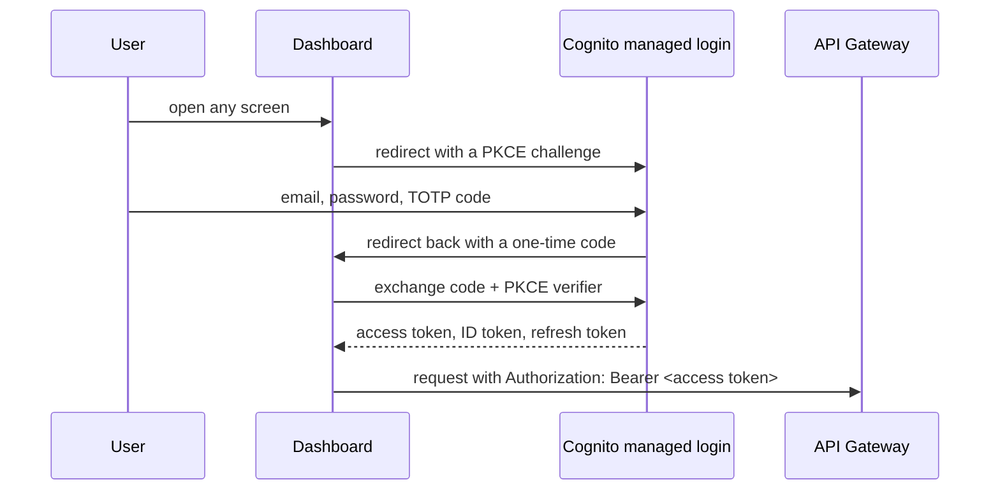

# Dashboard

## Purpose

A small React app to create agreements without Salesforce, watch them move through the pipeline, and download vaulted documents.

## Runs as

A React single-page app (TypeScript, built with Vite), deployed as a static site through SST.

## Screens

| Screen | Contents | Calls |
|---|---|---|
| Agreement list | Customer, amount, status, last updated; newest first | `GET /agreements` |
| Create agreement | Form: template, customer, amount, currency, signer name and email | `POST /agreements` with a generated idempotency key |
| Agreement detail | Current status and a timeline of every event; download buttons once vaulted | `GET /agreements/{id}`, then the Vault Service download route |
| Webhooks | Subscriptions, failed deliveries, a replay button | Notifier routes |

The list and detail screens poll every few seconds while an agreement is in progress. There is no push channel.

## Authentication

Users sign in through an Amazon Cognito user pool. The dashboard holds no passwords and no long-lived secret. The platform-wide rules are in the [architecture](../architecture.md#authentication-and-authorisation).

### Sign-in

The dashboard is a public OAuth client. It uses the authorization code flow with PKCE, through `oidc-client-ts` and `react-oidc-context`.

- Any screen opened without a valid session redirects to Cognito's managed login page. The dashboard has no login form of its own.
- Every API request carries the access token in the `Authorization` header. The ID token is used only to show the user's email in the header bar.
- Access tokens last 60 minutes. The library renews them with the refresh token, which lasts 8 hours and is rotated on each use. After 8 hours the user signs in again.
- Tokens are kept in session storage, so they are gone when the tab closes. Nothing is written to local storage.
- Signing out clears the stored tokens and redirects to Cognito's logout endpoint, which ends the Cognito session as well.

### Users and roles

There is no self sign-up. Users are created in the Cognito console or with the CLI, and must enrol a TOTP authenticator app at first sign-in. Each user belongs to one of two Cognito groups:

| Group | Can do |
|---|---|
| `viewer` | See the agreement list and detail, download vaulted documents, see webhook subscriptions and deliveries |
| `operator` | Everything a viewer can, plus create agreements, register webhook subscriptions, and replay failed deliveries |

The dashboard reads the `cognito:groups` claim and hides the create form, the subscription form, and the replay button from viewers. This is for convenience only. The API enforces the same rules on every request, so a hidden button is never the only protection.

### Handling rejections

| Response | Dashboard behaviour |
|---|---|
| `401` | Try one token renewal and repeat the request. If that fails, redirect to sign-in |
| `403` | Show a "you do not have permission" message; do not retry |

## Observability

The dashboard sends a `traceparent` header with each request, so a trace starts at the button click. See [observability](../observability.md).

## Done when

- Opening the dashboard without a session redirects to the Cognito sign-in page, and signing in returns to the screen first requested.
- A viewer sees no create form, and a `POST /agreements` sent by hand with a viewer's token returns `403`.
- A user who is disabled in Cognito can no longer call the API once their current access token expires.
- Signing out and pressing the browser's back button does not show agreement data.
- Submitting the create form shows the new agreement in the list with status `REQUESTED`.
- The detail screen shows the timeline advancing through each stage without a page reload.
- After vaulting, both download buttons return the files.
- A failed webhook delivery appears on the webhooks screen and can be replayed.
