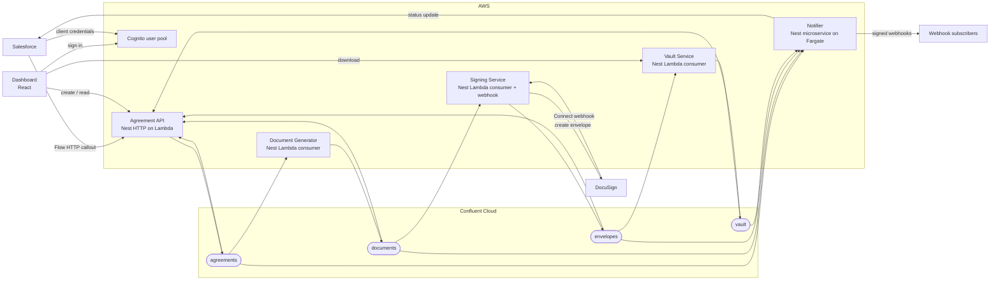
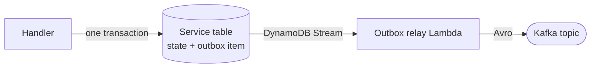

# Architecture

## Purpose and limits

This is a learning build. It is designed to exercise every technology in the brief in a realistic way, and to be finishable by one person working part time over a few weeks. It is not production hardened: there is no multi-region setup and no compliance work. Authentication is real but small: one Cognito user pool, two roles, and no single sign-on with a corporate directory.

It uses real external systems: a DocuSign developer sandbox, a Salesforce Developer Edition org, and a real AWS account.

## System overview



Every call into the API Gateway carries a token issued by the user pool. See [authentication and authorisation](#authentication-and-authorisation).

## The apps

| App | Runs as | Consumes | Produces | Owns |
|---|---|---|---|---|
| [Agreement API](apps/agreement-api.md) | NestJS HTTP on Lambda behind API Gateway, plus a Lambda consumer for the read model | all four topics (read model) | `agreements` | agreements table, timeline table |
| [Document Generator](apps/document-generator.md) | NestJS Lambda consumer | `agreements` | `documents` | documents table, drafts bucket |
| [Signing Service](apps/signing-service.md) | NestJS Lambda consumer, plus a webhook route | `documents` | `envelopes` | envelopes table, signed-staging bucket |
| [Vault Service](apps/vault-service.md) | NestJS Lambda consumer, plus a download route | `envelopes` | `vault` | vault table, vault bucket |
| [Notifier](apps/notifier.md) | Long-running NestJS Kafka microservice on Fargate, plus Lambda routes for subscriptions | all four topics | nothing | notifier table |
| [Dashboard](apps/dashboard.md) | React single-page app | nothing | nothing | nothing |

## Happy path

```mermaid
sequenceDiagram
    participant SF as Salesforce
    participant API as Agreement API
    participant GEN as Document Generator
    participant SIGN as Signing Service
    participant DS as DocuSign
    participant VAULT as Vault Service
    participant NOTE as Notifier

    SF->>API: POST /agreements (Closed Won)
    API-->>GEN: AgreementRequested
    GEN-->>SIGN: DocumentGenerated
    SIGN->>DS: create envelope
    SIGN-->>NOTE: EnvelopeSent
    Note over DS: signer signs (minutes to days)
    DS->>SIGN: Connect webhook (completed)
    SIGN->>DS: fetch signed PDF + certificate
    SIGN-->>VAULT: EnvelopeCompleted
    VAULT-->>NOTE: DocumentVaulted
    NOTE->>SF: update Opportunity status
```

Dashed arrows are Kafka events. The Notifier and the Agreement API's read model consume every event; only the first relevant one is drawn.

## Rules every service follows

These apply to all five backend apps. The shared package in the monorepo provides the code for each.

### One table per service

Each service has its own DynamoDB table. No service reads another service's table. Data crosses service boundaries only through events, with two stated exceptions for files:

- The Signing Service has read access to the Document Generator's drafts bucket, at the key given in `DocumentGenerated`.
- The Vault Service has read access to the Signing Service's signed-staging bucket, at the keys given in `EnvelopeCompleted`.

### Publishing: transactional outbox

A service never writes to DynamoDB and Kafka in the same handler. It writes its state change and an outbox item in one DynamoDB transaction. A DynamoDB Streams Lambda (the outbox relay) reads new outbox items and publishes them to Kafka.



The outbox item stores the serialised event, the target topic, the message key, and the trace context of the handler that wrote it.

### Consuming: idempotent, with a dead-letter queue

Kafka delivers at least once, and DocuSign resends webhooks. Every consumer:

1. Decodes the Avro payload using the schema registry client.
2. Attempts a conditional write of the event ID to its table. If the ID already exists, it stops and reports success.
3. Does its work and writes state plus any outbox item in one transaction with the event ID record.

A message that still fails after retries goes to an SQS dead-letter queue, one per consumer. Grafana alerts on any message in a dead-letter queue.

### Two consumer models

| Model | Used by | Who manages offsets |
|---|---|---|
| Lambda event source mapping | Agreement API read model, Document Generator, Signing Service, Vault Service | AWS polls the topic and invokes the function with batches |
| NestJS Kafka microservice | Notifier | The process holds its own connection and consumer group |

Lambda consumers boot NestJS as a standalone application context (modules and dependency injection, no HTTP server).

### One shared API Gateway

All HTTP routes sit on one API Gateway. Each service owns its routes:

| Route | Owner |
|---|---|
| `POST /agreements`, `GET /agreements`, `GET /agreements/{id}` | Agreement API |
| `POST /webhooks/docusign` | Signing Service |
| `GET /agreements/{id}/documents/{kind}/download` | Vault Service |
| `POST /webhook-subscriptions`, `GET /webhook-subscriptions`, `POST /webhook-deliveries/{id}/replay` | Notifier |

The gateway is an API Gateway HTTP API, because that type has a built-in JWT authorizer.

### Authentication and authorisation

There is no shared API key. Every caller proves who it is with a short-lived access token from one Cognito user pool. The DocuSign webhook is the one exception: it is authenticated by HMAC signature and has no authorizer.

**Callers**

| Caller | App client | OAuth flow | Holds a secret |
|---|---|---|---|
| Dashboard user | `dashboard` (public) | Authorization code with PKCE | No |
| Salesforce Flow | `salesforce` (confidential) | Client credentials | Yes, in a Salesforce External Credential |
| Smoke test | `smoke-test` (confidential) | Client credentials | Yes, in a GitHub environment secret |

Each caller has its own client, so one can be revoked or rotated without touching the others.

**Two checks on every request**

1. *Authentication, at the gateway.* The JWT authorizer checks the token's signature, issuer, expiry, and client ID against the user pool. A missing or invalid token gets `401` and no Lambda is invoked.
2. *Authorisation, in the service.* A guard in the shared package reads the verified claims and checks them against the permission the route needs. A valid token without that permission gets `403`. The guard also adds the caller's subject and client ID to the current span.

**Permissions**

A user's permissions come from their Cognito group, in the `cognito:groups` claim. A machine's permissions come from the scopes granted to its app client, in the `scope` claim. The scopes are defined on a Cognito resource server named `signing-api`.

| Route | Permission | `viewer` | `operator` | `salesforce` | `smoke-test` |
|---|---|---|---|---|---|
| `POST /agreements` | `agreements.write` | | yes | yes | yes |
| `GET /agreements`, `GET /agreements/{id}` | `agreements.read` | yes | yes | | yes |
| `GET /agreements/{id}/documents/{kind}/download` | `documents.download` | yes | yes | | |
| `GET /webhook-subscriptions` | `webhooks.read` | yes | yes | | |
| `POST /webhook-subscriptions`, `POST /webhook-deliveries/{id}/replay` | `webhooks.manage` | | yes | | |

The mapping from group to permissions lives in one file in the shared package. Routes declare the permission they need, never a group name, so adding a role later changes one file.

**User pool settings**

| Setting | Value |
|---|---|
| Self sign-up | Off; users are created by an administrator |
| Sign-in | Email and password through Cognito managed login |
| MFA | Required, TOTP authenticator app |
| Access token lifetime | 60 minutes |
| Refresh token lifetime | 8 hours, rotated on use (dashboard client only) |
| Groups | `viewer`, `operator` |

Disabling a user or deleting an app client stops new tokens at once. Tokens already issued stay valid until they expire, which is why the access token lifetime is short.

### External systems sit behind adapters

DocuSign and Salesforce are each called through one adapter interface. Unit tests use a fake implementation. Only the Signing Service calls DocuSign. Only the Notifier calls Salesforce.

## Infrastructure

| Piece | Choice | Notes |
|---|---|---|
| Infrastructure as code | SST | One config for all apps; Kafka topics declared through the Confluent provider |
| Kafka | Confluent Cloud, entry-tier cluster | Public endpoint with SASL; the cluster is created by hand once |
| Schema registry | Confluent Cloud Schema Registry | See the [event catalogue](event-catalogue.md) |
| Kafka client | `kafkajs` | NestJS's Kafka transport is built on it; pure JavaScript, so Lambda packaging stays simple |
| Stages | personal dev, `demo` | Dev is deployed from a laptop in SST live mode; `demo` is deployed only by the pipeline |
| Identity | Amazon Cognito user pool, one per stage | Declared in SST with its app clients, groups, and resource server; users are created by hand |
| Secrets | SST secrets per stage | DocuSign, Salesforce, and Kafka credentials; never in the repo |
| Monorepo tooling | pnpm workspaces, Vitest | |

### Cost notes

Checked November 2026. The Confluent and Grafana figures come partly from third-party summaries and they disagree in places, so confirm on each vendor's pricing page before relying on them.

- **Confluent Cloud**: the entry cluster tier has no base charge and bills for data in, data out, and storage, all negligible at this volume. New accounts get trial credit. Schema Registry's Essentials package has no base charge and includes 100 free schemas according to Confluent's documentation. Sources disagree on how many partitions the entry tier includes, so topics use 3 partitions each.
- **Grafana Cloud**: the free plan is reported as about 10,000 active metric series, 50 GB of logs and 50 GB of traces per month, 14-day retention, and 3 users.
- **AWS**: Lambda, API Gateway, DynamoDB, and S3 are free or close to it at this scale. The Notifier's Fargate task is the one always-on cost; stop it when not in use.
- **Cognito**: a handful of dashboard users falls inside the free allowance. Machine-to-machine clients are billed separately and are not covered by it: recalled, not checked, as about $6 per month per app client that uses client credentials, plus a small charge per token request. With two machine clients per stage that is the second always-on cost. Confirm on the Cognito pricing page; if it matters, delete the machine clients on the dev stage when not in use.

## Testing

| Layer | Runs against | Purpose |
|---|---|---|
| Unit | Fakes behind the DocuSign and Salesforce adapters | Business rules in each service |
| Integration | Kafka, schema registry, and DynamoDB Local in Docker | Outbox, consumers, idempotency, Avro round trips |
| End-to-end smoke | The deployed `demo` stage | One agreement from request to vaulted; run by the pipeline after each deploy |

## To verify during the build

These were assumed in the design and not confirmed against current documentation:

- That a Lambda event source mapping for self-managed Kafka supports an SQS on-failure destination in the chosen region.
- How SST passes Confluent SASL credentials to the event source mapping (AWS expects them in Secrets Manager).
- That the Confluent provider can be used from SST for topic creation with the entry-tier cluster's API keys.
- Whether the smoke test can complete an envelope in the DocuSign sandbox without a person signing. If it cannot, the automated smoke test stops at `SENT` and the signing and vaulting stages are checked by hand.
- Whether DocuSign's HMAC key can be set per envelope or only on an account-level Connect configuration.
- That the HTTP API JWT authorizer accepts Cognito access tokens from all three app clients when their client IDs are listed as audiences (access tokens carry `client_id`, not `aud`).
- That a Salesforce External Credential can run the client credentials flow against Cognito's token endpoint, including how it sends the client secret and the requested scope.
- That refresh token rotation is available on the user pool's feature tier, and that `oidc-client-ts` renews correctly with it.
- That SST's Cognito component can declare the resource server, scopes, and groups, or whether some need the underlying Pulumi resources.
