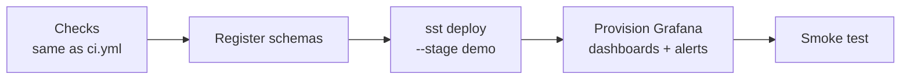

# CI/CD

The apps repo (`signing-platform-apps`) is built and deployed by GitHub Actions. The pipeline is set up in the foundation step, so every app ships through it from the start.

This documentation repo has no pipeline.

## What triggers what

| Trigger | Workflow | Result |
|---|---|---|
| Pull request | `ci.yml` | Checks only; nothing is deployed |
| Merge to `main` | `deploy.yml` | Deploys to the `demo` stage |

The personal dev stage is deployed from a laptop with SST's live mode and is never touched by the pipeline. There are no temporary per-pull-request stages.

## Pull request checks (`ci.yml`)

| Step | Detail |
|---|---|
| Install | pnpm with a cached store |
| Lint and typecheck | All packages |
| Generate types | Regenerate TypeScript from the `.avsc` files and fail if the result differs from what is committed |
| Unit tests | Vitest, with fakes behind the DocuSign and Salesforce adapters |
| Integration tests | Against Kafka, a schema registry, and DynamoDB Local started with Docker Compose in the runner |
| Schema compatibility | Check every `.avsc` file against the `demo` registry; fail on a `BACKWARD`-incompatible change |

## Deploy (`deploy.yml`)

Runs on merge to `main`, in the `demo` GitHub environment. Runs are queued, never run in parallel.

| Step | Detail |
|---|---|
| Checks | The same checks as a pull request |
| Register schemas | Register new schema versions with the registry before any code deploys, so new code never runs against a registry that lacks its schemas |
| Deploy | `sst deploy --stage demo`. Creates or updates Kafka topics (through the Confluent provider), all AWS resources, and the Notifier's container image |
| Provision Grafana | Push dashboard and alert rule JSON to Grafana Cloud |
| Smoke test | Fetch an access token with the client credentials flow, then create an agreement through the API and poll until it reaches `SENT`. A test-only step then completes the envelope in the DocuSign sandbox and the script polls until `VAULTED` |

If the smoke test fails, the run is marked failed. There is no automatic rollback and no manual approval step: a red run means `demo` is broken, and the fix is a new commit.

## Credentials

| Credential | Where it lives | Used by |
|---|---|---|
| AWS access | None stored. GitHub Actions assumes an IAM role through OIDC federation | Deploy |
| Confluent Cloud API key (cluster and registry admin) | GitHub environment secret | Schema registration, topic creation |
| Grafana Cloud API token | GitHub environment secret | Dashboard provisioning |
| Client ID and secret of the `smoke-test` Cognito app client | GitHub environment secret | Smoke test; exchanged for a 60-minute access token at the start of each run |
| DocuSign, Salesforce, and runtime Kafka credentials | SST secrets, set once per stage from a laptop | The running apps only; the pipeline never sees them |

### The AWS role

Created once, by hand or with a small bootstrap script, in the foundation step.

- Its trust policy allows only this repository, and only the `main` branch, to assume it.
- Pull request runs do not assume it. They need no AWS access.
- Its permissions cover what SST needs to deploy the stack. Start broad to get the pipeline working, then tighten.

## Done when

- A pull request with a failing test, a type error, or an incompatible schema change shows a failed check.
- A merge to `main` deploys to `demo` with no manual step and ends with a passing smoke test.
- No long-lived AWS access key exists in GitHub.
- Deleting a dashboard in Grafana and re-running the deploy restores it.
