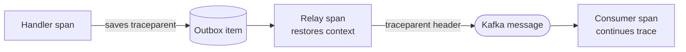

# Observability

All telemetry is produced with OpenTelemetry and viewed in Grafana. It is wired in at the foundation step, so every app is instrumented from the start.

## Where telemetry goes

| Environment | Destination |
|---|---|
| Deployed stages | Grafana Cloud free plan: Tempo (traces), Loki (logs), Mimir (metrics) |
| Local development | Grafana's all-in-one Docker image |

Both accept OTLP, so the apps change only an endpoint and credentials between environments.

## Signals

| Signal | Source | Notes |
|---|---|---|
| Traces | OpenTelemetry SDK auto-instrumentation (HTTP, AWS SDK, `kafkajs`) plus manual spans around business steps | |
| Metrics | Custom counters and histograms; consumer lag | See the list below |
| Logs | Structured JSON, one line per event | Every line carries the trace ID, span ID, correlation ID, and agreement ID |

The correlation ID is a business identifier and is set as an attribute on every span and log line. The trace ID does the technical linking between signals.

### Custom metrics

| Metric | Type | Labels |
|---|---|---|
| `events_published_total` | counter | service, topic, event type |
| `events_consumed_total` | counter | service, topic, event type, outcome (processed, duplicate, failed) |
| `outbox_relay_delay_ms` | histogram | service |
| `stage_duration_ms` | histogram | stage (generation, signing, vaulting) |
| `webhook_deliveries_total` | counter | outcome (success, retry, failed) |
| `dead_letter_messages` | gauge | service |

## How telemetry leaves each runtime

| Runtime | Method |
|---|---|
| Lambda | OpenTelemetry SDK in the function, exporting to the OpenTelemetry collector Lambda layer, which forwards to Grafana. The layer flushes outside the handler, so spans survive Lambda freezing the function |
| Notifier on Fargate | OpenTelemetry SDK exporting to a collector sidecar container |
| Dashboard | Sends a `traceparent` header only; no browser telemetry export |

The layer adds cold-start time. That cost is visible in the traces and is worth measuring as part of the build.

## Trace propagation

The goal is one trace that follows an agreement from the HTTP request to the vault, across every asynchronous hop.

| Hop | How context crosses it |
|---|---|
| HTTP | `traceparent` header (standard auto-instrumentation) |
| Handler to outbox relay | The handler saves `traceparent` on the outbox item. The relay restores it before publishing. Without this the trace breaks at every DynamoDB Streams hop |
| Kafka | `traceparent` and `tracestate` message headers |
| Lambda batch consumers | One span per message, each continuing that message's trace |
| The signing wait | A span link, described below |

### The signing wait

A signer may take days. A single trace that long is hard to read and many backends close traces well before then.

When the Signing Service creates an envelope, it saves the current trace context on the envelope record. When the DocuSign webhook arrives, the handler starts a new trace and adds a span link to the saved context. In Grafana, each trace shows a link to the other. The correlation ID is the same in both.

## Dashboards

Dashboards and alert rules are JSON files in the apps repo, provisioned to Grafana by the deploy pipeline.

| Dashboard | Shows |
|---|---|
| Pipeline health | Events published and consumed per service, consumer lag, outbox relay delay, dead-letter counts, error rates, Lambda cold starts and duration |
| Agreement lifecycle | Agreements by status, time spent in each stage, signing completion and decline rates, webhook delivery outcomes |

## Alerts

Alerts are defined in Grafana. CloudWatch still receives Lambda's built-in logs and metrics as a fallback, but nothing depends on it.

| Alert | Condition |
|---|---|
| Dead-letter message | Any message in any dead-letter queue |
| Consumer lag | Lag on any consumer group above a threshold for 5 minutes |
| Outbox stuck | Outbox relay delay above 1 minute |
| Webhook deliveries failing | Any delivery marked `FAILED` |
| Notifier down | No heartbeat metric from the Notifier for 5 minutes |

## Free plan limits

Reported limits for the Grafana Cloud free plan, checked November 2026 from third-party summaries: about 10,000 active metric series, 50 GB of logs and 50 GB of traces per month, 14-day retention, and 3 users. Keep metric label values bounded (never use agreement ID as a label) to stay within the series limit. Confirm the limits on Grafana's pricing page.
